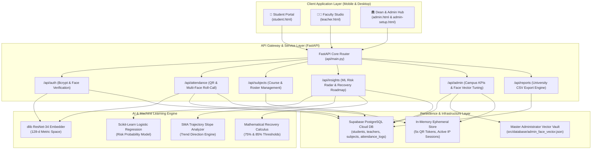
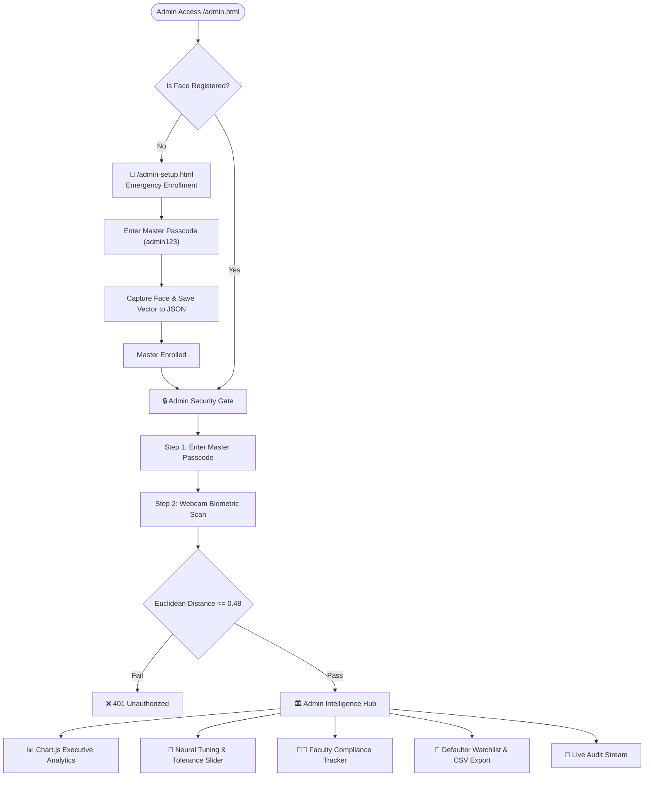
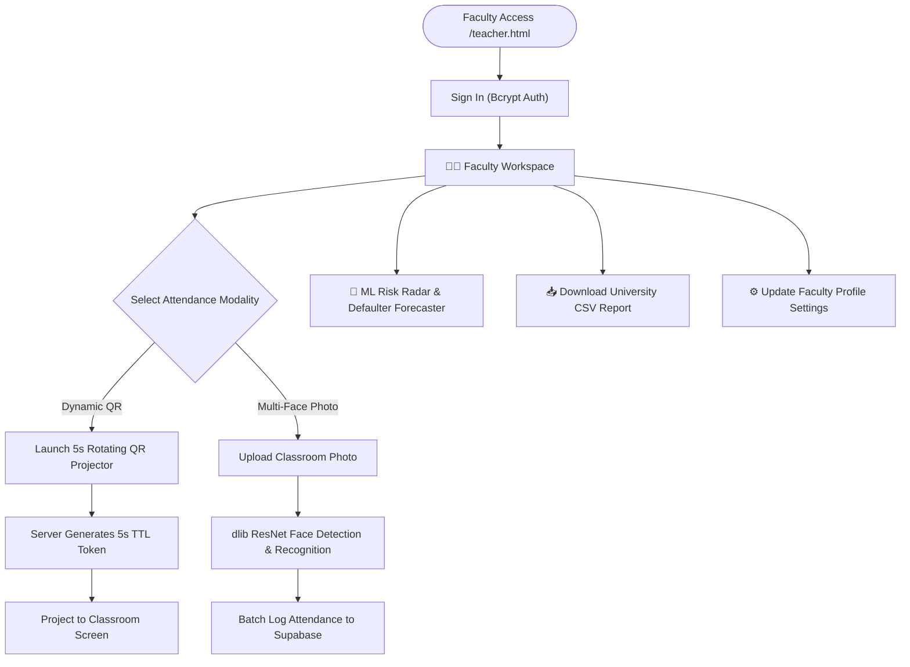
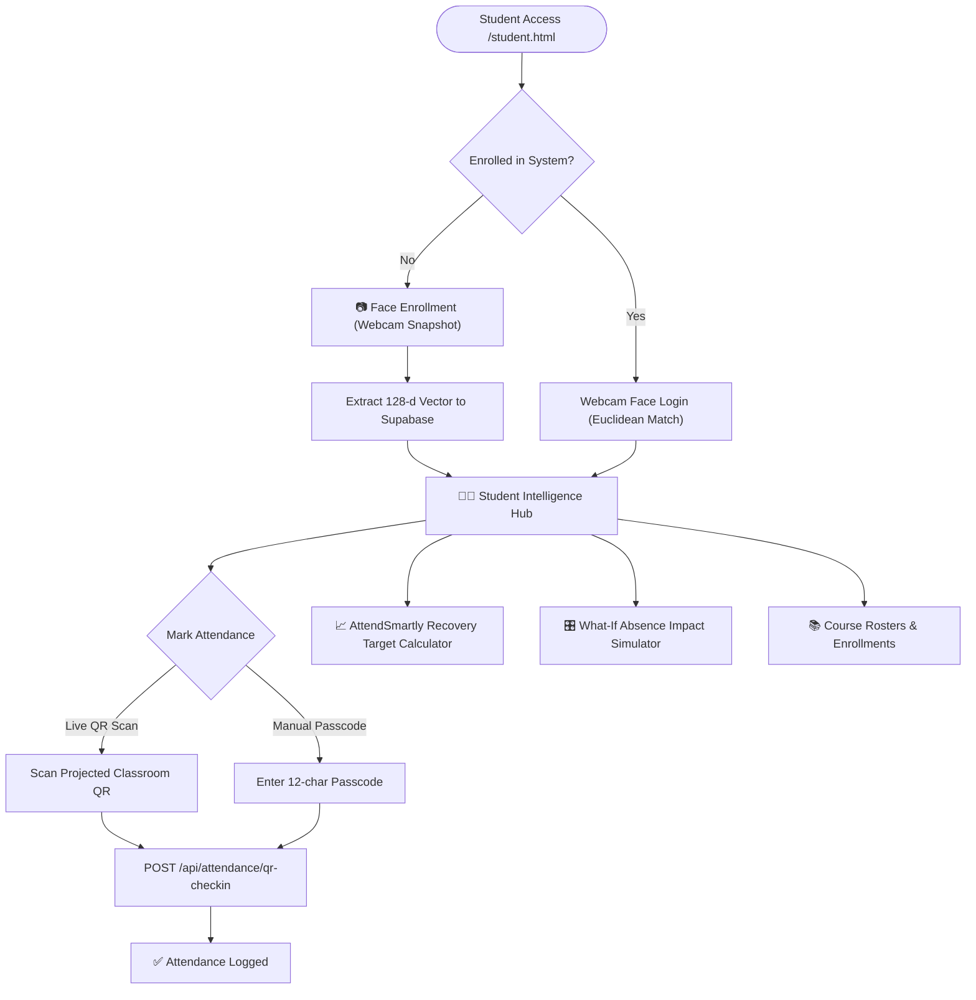
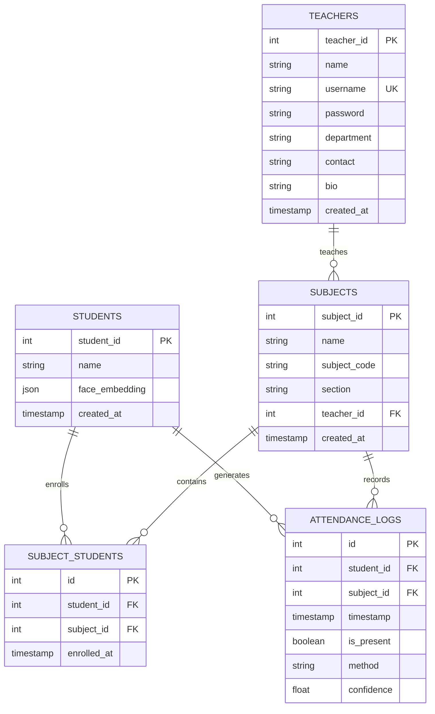

<div align="center">
  
  <h1>SnapClass 🎓</h1>
  <p><strong>Enterprise AI Biometric Attendance, Anti-Proxy Verification & Academic Recovery Intelligence</strong></p>
  
  [](https://python.org)
  [](https://fastapi.tiangolo.com)
  [](https://supabase.com)
  []()
  [](https://scikit-learn.org)
  [](https://www.chartjs.org)
  []()
</div>

---

## 📌 Table of Contents
- [Executive Overview](#-executive-overview)
- [System Architecture](#-system-architecture)
- [Role-Based Feature Matrix](#-role-based-feature-matrix)
  - [1. Student Intelligence Hub](#1--student-intelligence-hub-studenthtml)
  - [2. Faculty Studio](#2--faculty-studio-teacherhtml)
  - [3. Dean & Admin Compliance Hub](#3--dean--admin-compliance-hub-adminhtml)
- [Workflow & Role Sequence Diagrams](#-workflow--role-sequence-diagrams)
- [AI & Mathematical Foundations](#-ai--mathematical-foundations)
- [Complete REST API Specification](#-complete-rest-api-specification)
- [Database Schema & Entity Relationships](#-database-schema--entity-relationships)
- [Security & Privacy Architecture (OWASP 2025)](#-security--privacy-architecture-owasp-2025)
- [Default Test Credentials & Access Points](#-default-test-credentials--access-points)
- [Setup & Deployment Guide](setup.md)

---

## 🚀 Executive Overview

**SnapClass** redefines academic attendance management by replacing obsolete manual roll-calls with an end-to-end, multi-modal biometric and intelligence platform. 

Most institutional attendance systems act merely as passive digital registries. **SnapClass** bridges the gap by providing:
1. **Zero-Friction Biometrics**: 128-dimensional facial embedding recognition with multi-face classroom photo batch processing.
2. **Anti-Proxy Infrastructure**: 5-second dynamic rotating QR codes preventing snapshot sharing and unauthorized off-site check-ins.
3. **Actionable Predictive Intelligence**: Scikit-Learn logistic regression models and moving-average trajectory slope detectors that identify at-risk students weeks before university debarment.
4. **Mathematical Recovery Roadmaps**: AttendSmartly-inspired formulas that project exact class attendance targets to reach 75% minimum eligibility and 85% honors standing.

---

## 🏗️ System Architecture



---

## 👥 Role-Based Feature Matrix

### 1. 👨‍🎓 Student Intelligence Hub (`student.html`)
* **Facial Biometric Entrance**: Align face in the optical viewfinder for 1-to-1 Euclidean distance matching to log in without memorizing passwords.
* **Biometric Self-Enrollment**: High-speed camera enrollment extracting and persisting 128-d face descriptors.
* **Live In-Classroom QR Scanner**: Integrated camera scanner (`html5-qrcode`) that scans rotating classroom codes or accepts manual 12-character session passcodes.
* **Cumulative Standing Gauge**: Circular SVG radial meter dynamically color-coded to status (*Safe $\ge 85\%$*, *Warning $75-84\%$*, *Debarred $<75\%$*).
* **Attendance Recovery Target Calculator**:
  * Calculates exact consecutive classes required to reach **75% Examination Eligibility**.
  * Calculates exact consecutive classes required to reach **85% Honors Standing**.
* **Subject-Wise Standing Cards**: Displays subject percentage, safe-skips remaining, and class recovery quotas.
* **Interactive What-If Absence Simulator**: Live slider projecting exact future attendance percentages based on prospective missed classes.
* **Course Roster Management**: Join courses with Course IDs and manage active enrollments.
* **Chronological Verification History**: Transparent audit trail showing verification timestamp and modality.

---

### 2. 👨‍🏫 Faculty Studio (`teacher.html`)
* **Bcrypt-Secured Faculty Authentication**: Register and log in with salted hash password security.
* **5-Second Dynamic Rotating QR Projector**: Projects rolling, anti-proxy QR codes with countdown timers and dynamic passcodes for in-classroom check-in.
* **Classroom Group Multi-Face Recognition**: Upload a high-resolution classroom group photo to identify and mark all enrolled students in one single batch pass.
* **Predictive Attendance Risk Radar**: Scikit-Learn machine learning radar analyzing 30-day attendance trends, computing statistical risk probabilities and recovery actions.
* **Course & Section Management**: Create new courses, view student enrollment rosters, and copy course registration codes.
* **University-Compliant CSV Reports**: 1-click export of complete course roll-call logs formatted for institutional reporting.
* **Faculty Profile Settings**: Edit full name, academic title, department, email contact, and update passwords.

---

### 3. 🏛️ Dean & Admin Compliance Hub (`admin.html` & `admin-setup.html`)
* **Dual-Factor Biometric Security Gate (2FA)**: Access requires the Master Security Key (`admin123`) combined with real-time facial biometric verification ($\text{distance} \le 0.48$).
* **Emergency Biometric Setup Portal (`admin-setup.html`)**: Dedicated portal for initial master administrator face enrollment and vector calibration.
* **Executive Analytics & AI Insights**:
  * 📈 **7-Day Campus Attendance Trend**: Smooth cubic bezier curve chart of overall university participation.
  * 🍩 **Attendance Risk Breakdown**: Donut chart showing campus proportions of Safe, Warning, and Debarred students.
  * 📊 **Cross-Course Performance Comparison**: Side-by-side bar chart benchmarking attendance rates across departments.
* **AI Summary Engine & 1-Click Action Dispatcher**: Automated alerts synthesizing debarment risk, biometric health, and Friday afternoon drops with 1-click triggers (*Dispatch Warnings*, *Nudge Faculty*, *Propose Schedule Shift*).
* **Face Vector Database & Neural Tuning Studio**: Enrolled student vector directory with interactive **Euclidean Tolerance Slider** ($0.45 \longleftrightarrow 0.65$) and preset modes (*Strict*, *Balanced*, *Lenient*).
* **Faculty Roll-Call Compliance Tracker**: Daily audit checklist showing faculty session completion status with 1-click reminder triggers.
* **Customizable Defaulter Watchlist**: Dynamic cutoff threshold filter ($50\% - 100\%$) with real-time defaulter calculation and 1-click official examination CSV export.
* **Live Institutional Audit Feed**: Chronological verification log showing live check-ins with confidence ratings.

---

## 🔄 Workflow & Role Sequence Diagrams

### 1. Admin Authentication & Management Sequence


### 2. Faculty Roll-Call & Analytics Sequence


### 3. Student Check-In & Recovery Sequence


---

## 🧠 AI & Mathematical Foundations

### 1. 128-Dimensional Deep Metric Face Recognition
Facial biometrics utilize a ResNet-34 deep convolutional network trained on triplet loss to map facial images into a 128-dimensional Euclidean space. Verification is computed via vector distance:

$$\text{Distance}(v_1, v_2) = \sqrt{\sum_{i=1}^{128} (v_{1,i} - v_{2,i})^2}$$

* **Matching Threshold**: $\text{Distance} \le \text{Threshold}$ (Configurable via Admin Tuning Slider: $0.45 \longleftrightarrow 0.65$, Default: $0.55$).

---

### 2. 128-Dimensional Acoustic Voice Biometric Modeling
Voice biometrics utilize a 128-dimensional L2-normalized acoustic descriptor combining 20-order Mel-Frequency Cepstral Coefficients (MFCCs: mean, std, max, min = 80 dims), delta temporal derivatives (40 dims), and spectral dynamics (spectral centroid, bandwidth, zero-crossing rate, energy statistics = 8 dims). Verification is computed via cosine similarity:

$$\text{Similarity}(u_1, u_2) = \frac{u_1 \cdot u_2}{\|u_1\|_2 \|u_2\|_2}$$

* **Speaker Identification Threshold**: $\text{Similarity} \ge 0.60$.

---

### 3. Scikit-Learn Logistic Regression Attendance Risk Modeling
Predictive risk modeling estimates the probability of a student falling below examination thresholds based on rolling attendance patterns:

$$P(\text{Debarment} \mid X) = \frac{1}{1 + e^{-(\beta_0 + \beta_1 X_{\text{rate}} + \beta_2 X_{\text{trend}} + \beta_3 X_{\text{streak}})}}$$

* **SAFE**: Attendance $\ge 85\%$ or $P(\text{Debarment}) < 0.25$
* **WARNING**: Attendance $75\% - 84\%$ or $0.25 \le P(\text{Debarment}) < 0.70$
* **CRITICAL**: Attendance $< 75\%$ or $P(\text{Debarment}) \ge 0.70$

---

### 4. AttendSmartly Recovery & Buffer Calculus
Given total scheduled classes $T$, attended classes $A$, and minimum eligibility threshold $R = 0.75$ ($75\%$):

* **Classes Needed to Reach 75%**:
  $$\text{Classes Needed} = \max\left(0, \left\lceil \frac{0.75 \cdot T - A}{0.25} \right\rceil\right) = \max\left(0, \left\lceil 3T - 4A \right\rceil\right)$$

* **Safe Buffer Absences Allowed**:
  $$\text{Safe Skips} = \max\left(0, \left\lfloor \frac{A - 0.75 \cdot T}{0.75} \right\rfloor\right) = \max\left(0, \left\lfloor \frac{4A - 3T}{3} \right\rfloor\right)$$

---

## 🔌 Complete REST API Specification

### Authentication (`/api/auth`)
| Method | Endpoint | Description | Payload Format |
|---|---|---|---|
| `POST` | `/api/auth/teacher/login` | Authenticate faculty account | JSON / Form: `{ username, password }` |
| `POST` | `/api/auth/teacher/register` | Register new faculty account | JSON / Form: `{ name, username, password }` |
| `PUT` | `/api/auth/teacher/profile/{id}` | Update faculty profile & credentials | JSON / Form: `{ name, username, password, department, contact, bio }` |
| `POST` | `/api/auth/student/face-login` | 1-to-1 Facial Biometric Student Login | `multipart/form-data`: `image` (JPEG/PNG) |
| `POST` | `/api/auth/student/register` | Enroll new student facial descriptor | `multipart/form-data`: `name`, `image` |
| `POST` | `/api/auth/student/voice-enroll` | Enroll 128-d acoustic speaker vector | `multipart/form-data`: `student_id`, `audio` (WAV/MP3) |

### Attendance & Roll-Call (`/api/attendance`)
| Method | Endpoint | Description | Payload Format |
|---|---|---|---|
| `GET` | `/api/attendance/qr-token?subject_id={id}` | Generate rotating 5-second dynamic token | Query Param: `subject_id` |
| `POST` | `/api/attendance/qr-checkin` | Direct student camera QR check-in | Form / JSON: `subject_id`, `token`, `student_id` |
| `POST` | `/api/attendance/qr-submit` | Dual FaceID + QR token check-in | `multipart/form-data`: `subject_id`, `token`, `image` |
| `POST` | `/api/attendance/recognize-multi` | Group classroom photo recognition | `multipart/form-data`: `subject_id`, `image` |
| `POST` | `/api/attendance/recognize-voice` | Group classroom audio roll-call scan | `multipart/form-data`: `subject_id`, `audio` (WAV/MP3/M4A) |

### Subjects & Rosters (`/api/subjects`)
| Method | Endpoint | Description | Payload Format |
|---|---|---|---|
| `GET` | `/api/subjects/teacher/{teacher_id}` | List courses taught by faculty | Query / Path |
| `POST` | `/api/subjects/create` | Create new academic course | JSON: `{ name, subject_code, section, teacher_id }` |
| `GET` | `/api/subjects/student/{student_id}` | List courses enrolled by student | Query / Path |
| `POST` | `/api/subjects/enroll` | Enroll student into subject roster | JSON: `{ student_id, subject_id }` |
| `DELETE` | `/api/subjects/{subject_id}` | Delete course offering | Path |
| `DELETE` | `/api/subjects/unenroll` | Unenroll student from course | Query Params: `student_id`, `subject_id` |

### AI Insights & Analytics (`/api/insights`)
| Method | Endpoint | Description | Payload Format |
|---|---|---|---|
| `GET` | `/api/insights/student-radar/{student_id}` | Cumulative gauge, habits & streak data | Path |
| `GET` | `/api/insights/student-recovery/{student_id}` | Recovery target roadmap & subject breakdown | Path |
| `GET` | `/api/insights/risk/{subject_id}` | Scikit-Learn risk radar for course | Path |

### Dean & Admin Hub (`/api/admin`)
| Method | Endpoint | Description | Payload Format |
|---|---|---|---|
| `POST` | `/api/admin/login-2fa` | Admin Master Key + Facial 2FA verification | `multipart/form-data`: `passcode`, `image` |
| `POST` | `/api/admin/register-admin-face` | Emergency Master Face Vector Enrollment | `multipart/form-data`: `passcode`, `image` |
| `GET` | `/api/admin/overview` | Campus KPI metrics ribbon | Header: `X-Admin-Token` |
| `GET` | `/api/admin/analytics` | Chart.js time-series, donut & bar data | Header: `X-Admin-Token` |
| `GET` | `/api/admin/face-gallery` | Student 128-d vector database status | Header: `X-Admin-Token` |
| `POST` | `/api/admin/tuning` | Save Euclidean tolerance threshold | JSON: `{ threshold: 0.55 }` |
| `GET` | `/api/admin/faculty-compliance` | Faculty daily roll-call compliance tracker | Header: `X-Admin-Token` |
| `GET` | `/api/admin/defaulters?threshold={pct}` | Customizable cutoff defaulters watchlist | Query Param: `threshold` (50-100) |
| `POST` | `/api/admin/trigger-action` | Trigger 1-click administrative actions | JSON: `{ action_type: "dispatch_warnings" }` |
| `GET` | `/api/reports/export/{subject_id}` | University CSV attendance spreadsheet export | Path |

---

## 🗄️ Database Schema & Entity Relationships



---

## 🔒 Security & Privacy Architecture (OWASP 2025)

* **Zero Raw Image Storage**: The system extracts 128-dimensional floating point numerical descriptors and discards raw face snapshots immediately. No raw biometrics are stored on disk or database.
* **Dual-Factor Administrative Authentication**: Administrative session issuance strictly mandates both possession factor (Master Security Key) and biometric factor (Administrator Face Vector).
* **Bcrypt Password Salting & Hashing**: All faculty passwords undergo salted 12-round `bcrypt` hashing before storage.
* **Anti-Replay Time-Bound Tokens**: Classroom QR codes rotate every 5 seconds with cryptographic TTL verification, rendering screenshots and forwarded tokens useless.
* **Role-Based Access Control (RBAC)**: Clear architectural boundary separating Student, Faculty, and Dean administrative capabilities.

---

## 🛠️ Installation & Quickstart Guide

### 1. Prerequisites
- **Python 3.11+** installed
- **CMake** (required for `dlib` compilation on C++ backend)

### 2. Clone and Setup Environment
```bash
git clone https://github.com/Bhanuprakashdev-prog/snapclass.git
cd snapclass

# Create and activate virtual environment
python -m venv venv
# Windows:
venv\Scripts\activate
# Linux/macOS:
source venv/bin/activate

# Install dependencies
pip install -r requirements.txt
```

### 3. Configure Supabase Cloud Database
Create `.streamlit/secrets.toml` in the project root:
```toml
SUPABASE_URL = "https://your-project.supabase.co"
SUPABASE_KEY = "your-anon-or-service-key"
```

### 4. Seed Synthetic Benchmark Data (Optional)
To seed 15 students (with 128-d face descriptors), 3 courses, 2 faculty members, and 910 historical attendance records for active ML risk models:
```bash
python seed_db.py
```

### 5. Launch the Server
```bash
# Standard local execution:
python run_server.py

# Or via Uvicorn directly:
uvicorn api.main:app --host 0.0.0.0 --port 8000 --reload
```

---

## 🔑 Default Test Credentials & Access Points

| Portal | URL | Credentials / Authentication |
|---|---|---|
| 👨‍🎓 **Student Hub** | `http://localhost:8000/student.html` | Face Login or Selfie Self-Enrollment |
| 👨‍🏫 **Faculty Studio** | `http://localhost:8000/teacher.html` | Username: `prof_turing`<br/>Password: `teacher123` |
| 🏛️ **Dean & Admin Hub** | `http://localhost:8000/admin.html` | Master Key: `admin123` + Biometric 2FA |
| 🚨 **Admin Face Setup** | `http://localhost:8000/admin-setup.html` | Master Key: `admin123` (Initial Vector Enrollment) |

---

<div align="center">
  <p>SnapClass — Built for GTU Academic Minor Project.</p>
</div>