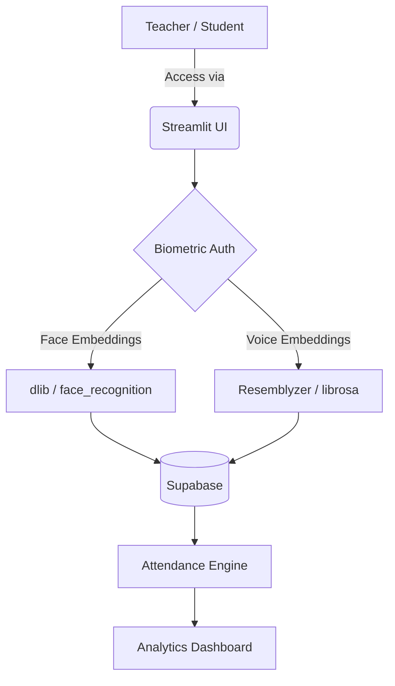

<div align="center">
  
  <h1>SnapClass 📸</h1>
  <p><strong>AI-Powered Student Attendance & Engagement System</strong></p>
  
  [](https://python.org)
  [](https://streamlit.io)
  [](https://supabase.com)
  []()
</div>

---

## 🚀 Overview

**SnapClass** redefines how attendance is managed in modern classrooms. Moving beyond simple face recognition, it provides a comprehensive suite of tools designed to automate attendance tracking, prevent proxies, and deliver actionable AI-driven insights to educators.

Whether you're a teacher looking to save 15 minutes of class time or a student keeping track of your own metrics, SnapClass makes the experience frictionless.

### ✨ Key Features

- 👤 **FaceID Authentication:** Students log in seamlessly using their face.
- 📸 **Automated Attendance:** Teachers upload classroom photos, and the deep-learning pipeline instantly identifies enrolled students.
- 🎙️ **Voice Verification (Optional):** Dual-factor biometric attendance using voice embeddings (`resemblyzer`).
- 🛡️ **Anti-Proxy Infrastructure:** *[Upcoming]* Liveness detection to ensure physical presence.
- 📊 **Teacher Dashboard:** Create subjects, manage enrollments, and track live attendance metrics.
- 📉 **Predictive Analytics:** *[Upcoming]* AI risk scoring to identify students dropping below required attendance thresholds.

---

## 🏗️ System Architecture



---

## ⚙️ Installation & Setup

### 1. Clone the Repository

### 2. Install Dependencies
Make sure you have CMake installed (required for `dlib`), then run:
```bash
pip install -r requirements.txt
```

### 3. Environment Variables
Create a `.streamlit/secrets.toml` file with your Supabase credentials:
```toml
SUPABASE_URL = "your-supabase-url"
SUPABASE_KEY = "your-supabase-key"
```

### 4. Run the Application
```bash
streamlit run app.py
```

---

## 📂 Project Structure

```text
snapclass/
├── .streamlit/             # Config and Secrets
├── src/
│   ├── components/         # Reusable UI Dialogs (Enroll, Share, etc.)
│   ├── database/           # Supabase Integration & Auth (bcrypt)
│   ├── pipelines/          # AI Models (Face & Voice Pipelines)
│   ├── screens/            # Main Views (Teacher, Student, Home)
│   └── ui/                 # Styling and Layout Settings
├── app.py                  # Application Entry Point
└── requirements.txt        # Python Dependencies
```

---

## 🔒 Security & Privacy (OWASP 2025 Aligned)
- **Zero Trust Biometrics:** Face and voice embeddings are stored as mathematical arrays, not as raw images or audio files.
- **Secure Authentication:** Teacher passwords are salted and hashed using `bcrypt`.
- **RBAC:** Strict separation of concerns between Teacher and Student routing.

---

<div align="center">
  <p>Built for GTU Minor Project.</p>
</div>