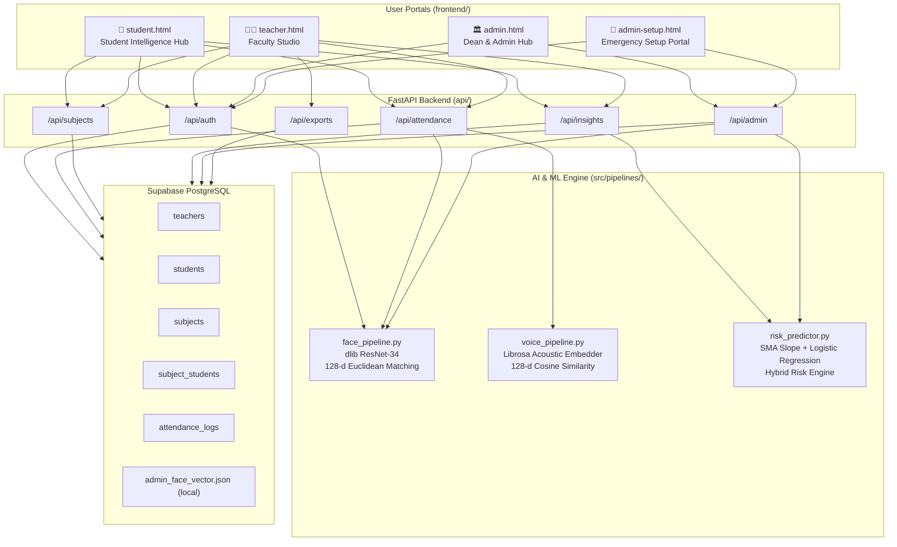

# SnapClass — Complete Feature Registry

> **Project:** AI-Powered Student Attendance Management System (G5)  
> **Stack:** FastAPI · Vanilla HTML/CSS/JS · Supabase PostgreSQL · dlib ResNet-34 · Scikit-Learn  
> **Status:** Production-Ready (Seminar IV — Final Demonstration)

---

## System Map

---

## Feature Registry by Role

### 🎓 Student Features (`student.html`)

| # | Feature | Description | API Endpoint |
|---|---------|-------------|--------------|
| S1 | **Biometric Face Enrollment** | Register via webcam snapshot → 128-d dlib vector stored in Supabase | `POST /api/auth/student/register` |
| S2 | **Face Login (Passwordless)** | Log in using facial recognition — no credentials needed | `POST /api/auth/student/face-login` |
| S3 | **Voice Biometric Enrollment** | Record 3–5 seconds of speech → 128-d acoustic embedding stored | `POST /api/auth/student/voice-enroll` |
| S4 | **Live QR Camera Scan** | Scan rotating classroom QR code via `html5-qrcode` to mark presence | `POST /api/attendance/qr-checkin` |
| S5 | **Manual Passcode Check-In** | Enter 12-character session token manually (alternate to QR scan) | `POST /api/attendance/qr-checkin` |
| S6 | **Attendance Standing Gauge** | SVG radial meter: Safe ≥85% · Warning 75–84% · Debarred <75% | `GET /api/insights/student-radar/{id}` |
| S7 | **Recovery Target Calculator** | Exact classes needed to reach 75% eligibility and 85% honors | `GET /api/insights/student-recovery/{id}` |
| S8 | **What-If Absence Simulator** | Live slider projecting attendance % if N future classes are skipped | Client-side math |
| S9 | **Subject-Wise Standing Cards** | Per-course attendance %, safe skips remaining, recovery quota | `GET /api/insights/student-recovery/{id}` |
| S10 | **Attendance Streak Tracker** | Consecutive present days streak display | `GET /api/insights/student-radar/{id}` |
| S11 | **Day-of-Week Habit Analysis** | Which days student most often misses class | `GET /api/insights/student-radar/{id}` |
| S12 | **Chronological Audit History** | Last 10 verified attendance entries with method & timestamp | `GET /api/insights/student-recovery/{id}` |
| S13 | **Course Enrollment** | Join courses using Course ID provided by faculty | `POST /api/subjects/enroll` |
| S14 | **Course Roster Management** | View all enrolled subjects and unenroll | `GET /api/subjects/student/{id}` |

---

### 👨‍🏫 Faculty Features (`teacher.html`)

| # | Feature | Description | API Endpoint |
|---|---------|-------------|--------------|
| F1 | **Bcrypt-Secured Login** | Salted 12-round bcrypt faculty authentication | `POST /api/auth/teacher/login` |
| F2 | **Faculty Registration** | Self-service faculty account creation | `POST /api/auth/teacher/register` |
| F3 | **Profile Management** | Update name, department, contact, bio, password | `PUT /api/auth/teacher/profile/{id}` |
| F4 | **5s Rotating QR Projector** | Dynamic QR code rotating every 5 seconds for classroom display | `GET /api/attendance/qr-token` |
| F5 | **Countdown Timer Display** | Live countdown showing seconds until next QR rotation | Client-side |
| F6 | **12-char Passcode Display** | Text backup for students unable to scan | Client-side |
| F7 | **Group Photo Face Scan** | Upload classroom group photo → batch-identify all enrolled faces | `POST /api/attendance/photo-scan` |
| F8 | **Voice Roll-Call Scan** | Upload classroom audio → identify all enrolled speakers via voice | `POST /api/attendance/voice-scan` |
| F9 | **ML Risk Radar** | Scikit-Learn logistic regression + SMA trend for all course students | `GET /api/insights/risk/{subject_id}` |
| F10 | **Course Creation** | Create new academic course with code, section, teacher ID | `POST /api/subjects/create` |
| F11 | **Student Roster View** | See all enrolled students per course | `GET /api/subjects/teacher/{id}` |
| F12 | **Registration Code Copy** | One-click copy of Course ID for distribution to students | Client-side |
| F13 | **CSV Report Export** | University-compliant attendance spreadsheet | `GET /api/exports/attendance/{id}` |
| F14 | **JWT Session Auth** | 8-hour stateless cryptographic session token | `GET /api/auth/verify-session` |

---

### 🏛️ Admin Features (`admin.html` + `admin-setup.html`)

| # | Feature | Description | API Endpoint |
|---|---------|-------------|--------------|
| A1 | **2FA Biometric Security Gate** | Master Key + facial biometric verification (Euclidean ≤ 0.48) | `POST /api/admin/login-2fa` |
| A2 | **Emergency Face Setup Portal** | Initial admin face vector enrollment | `POST /api/admin/register-admin-face` |
| A3 | **Admin Audit Log** | IP, user-agent, status, face confidence for every login attempt | In-memory |
| A4 | **7-Day Attendance Trend Chart** | Chart.js bezier line chart of campus-wide attendance | `GET /api/admin/analytics` |
| A5 | **Risk Breakdown Donut Chart** | Safe / Warning / Debarred proportion visualization | `GET /api/admin/analytics` |
| A6 | **Cross-Course Bar Chart** | Side-by-side attendance rate comparison across subjects | `GET /api/admin/analytics` |
| A7 | **Campus KPI Ribbon** | Total students, active courses, avg attendance % | `GET /api/admin/overview` |
| A8 | **AI Summary Engine** | Auto-synthesized debarment risk alert with 1-click actions | `GET /api/admin/overview` |
| A9 | **1-Click Action Dispatcher** | Dispatch Warnings · Nudge Faculty · Propose Schedule Shift | `POST /api/admin/trigger-action` |
| A10 | **Face Vector Gallery** | Directory of enrolled student 128-d vector status | `GET /api/admin/face-gallery` |
| A11 | **Neural Tuning Slider** | Euclidean tolerance (0.45–0.65) with Strict/Balanced/Lenient presets | `POST /api/admin/tuning` |
| A12 | **Faculty Compliance Tracker** | Daily checklist of faculty roll-call completion | `GET /api/admin/faculty-compliance` |
| A13 | **Defaulter Watchlist** | Configurable cutoff (50–100%) with real-time defaulter calculation | `GET /api/admin/defaulters` |
| A14 | **Exam Eligibility CSV Export** | University-format debarment list for exam office | `GET /api/admin/defaulters` |
| A15 | **Live Institutional Audit Feed** | Real-time chronological verification feed with confidence ratings | In-memory sessions |

---

## AI & Mathematical Core

| Component | Technology | Purpose |
|-----------|-----------|---------|
| Face Detection | dlib HOG Frontal Face Detector | Locate face regions in image |
| Face Embedding | dlib ResNet-34 (128-d) | Map face to Euclidean metric space |
| Face Matching | L2 Euclidean Distance ≤ 0.55 | Verify identity |
| Voice Embedding | Librosa MFCC 128-d (fallback from Resemblyzer) | Map voice to cosine space |
| Voice Matching | Cosine Similarity ≥ 0.60 | Verify speaker |
| Risk Prediction | Scikit-Learn Logistic Regression (≥10 rows) | Probability of debarment |
| Trend Analysis | SMA-5 Slope Detector (primary signal) | Attendance trajectory direction |
| Recovery Math | AttendSmartly Calculus | Classes needed for 75%/85% |

---

*Last updated: October 2026 — Seminar IV Final*
