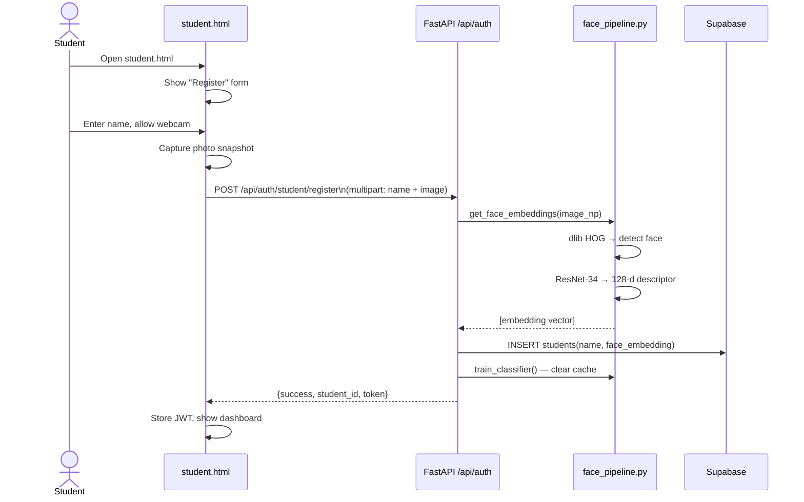
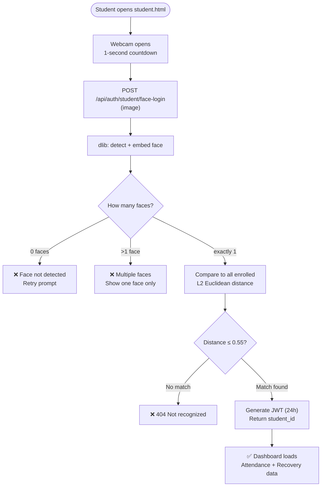
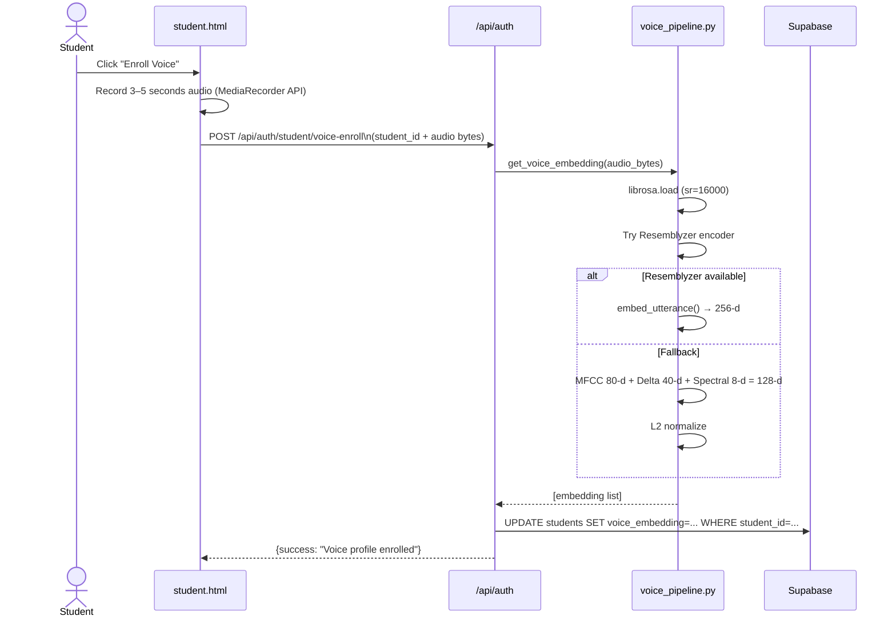
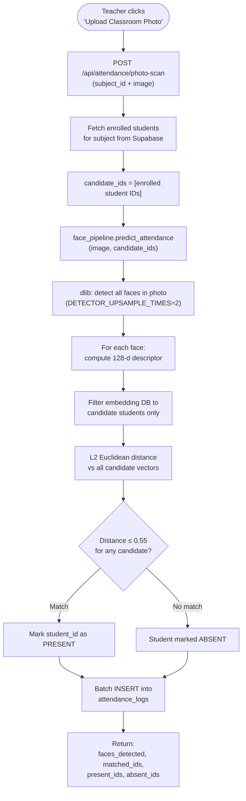
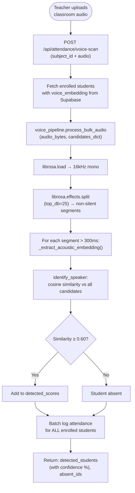
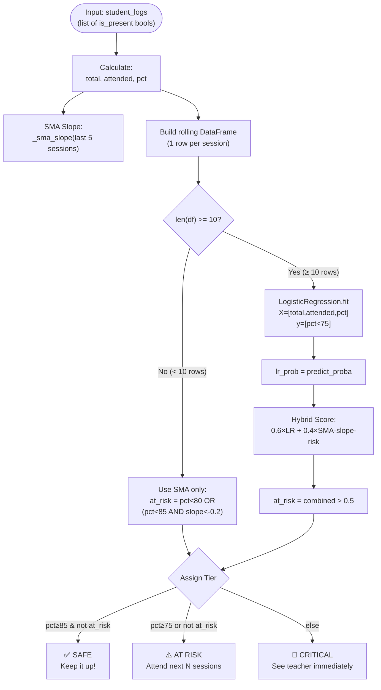
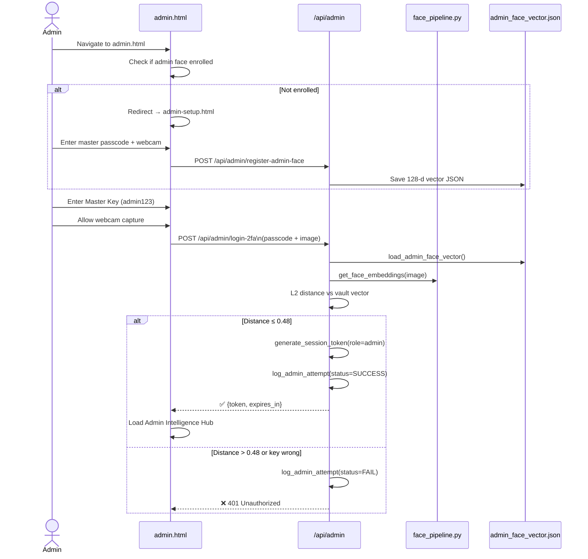
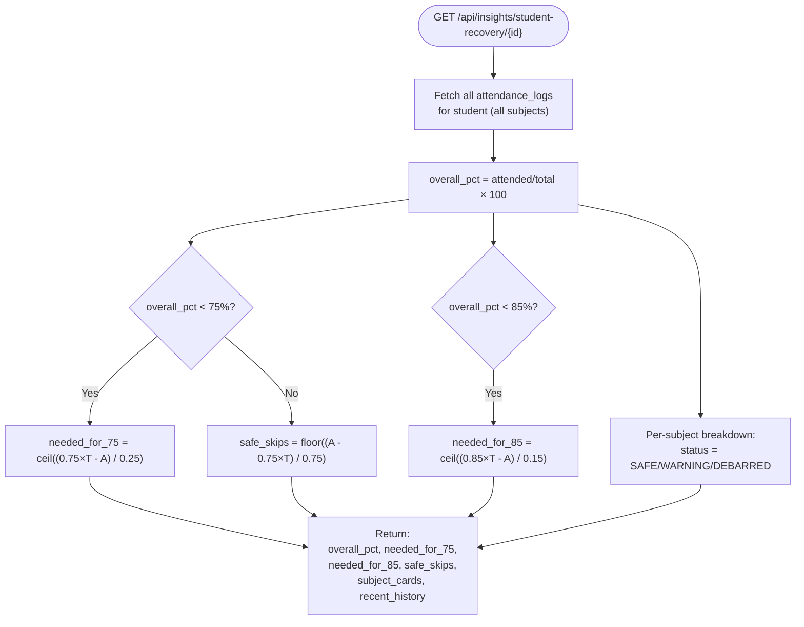
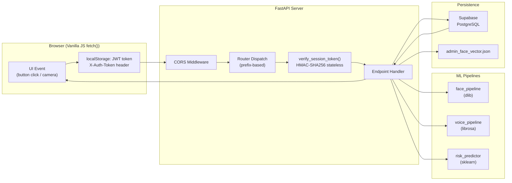

# SnapClass — Workflow Diagrams

> All major system workflows with Mermaid sequence and flow diagrams.

---

## 1. Student Registration & Face Enrollment



---

## 2. Student Face Login



---

## 3. Voice Biometric Enrollment



---

## 4. Faculty QR Attendance — Anti-Proxy Rotating Token

```mermaid
sequenceDiagram
    participant Teacher as Faculty Browser
    participant API as /api/attendance
    participant Timer as 5s Timer Loop
    participant Student as Student Browser

    Teacher->>API: GET /api/attendance/qr-token?subject_id=X
    API->>API: bucket = int(time.time()) // 5
    API->>API: SHA-256(subject_id:bucket:SECRET)[:12]
    API-->>Teacher: {token, bucket}
    Teacher->>Teacher: Render QR code + countdown
    Note over Timer: Every 5 seconds...
    Timer->>Teacher: Token refreshed → new QR displayed
    
    Student->>Student: Scan QR with html5-qrcode camera
    Student->>API: POST /api/attendance/qr-checkin\n(subject_id, token, student_id)
    API->>API: verify_qr_token: check bucket±1
    alt Token valid
        API->>API: Check enrollment; auto-enroll if missing
        API->>API: create_attendance(is_present=True)
        API-->>Student: ✅ Attendance recorded
    else Token expired/invalid
        API-->>Student: ❌ 400 Invalid or expired QR token
    end
```

---

## 5. Group Photo Face Scan (Classroom Roll-Call)



---

## 6. Voice Roll-Call (Audio Speaker Identification)



---

## 7. AI Risk Predictor — Hybrid SMA + Logistic Regression



---

## 8. Admin 2FA Biometric Security Gate



---

## 9. AttendSmartly Recovery Calculator



---

## 10. Complete Request-Response Architecture



---

*All diagrams reflect the live production codebase — October 2026*
