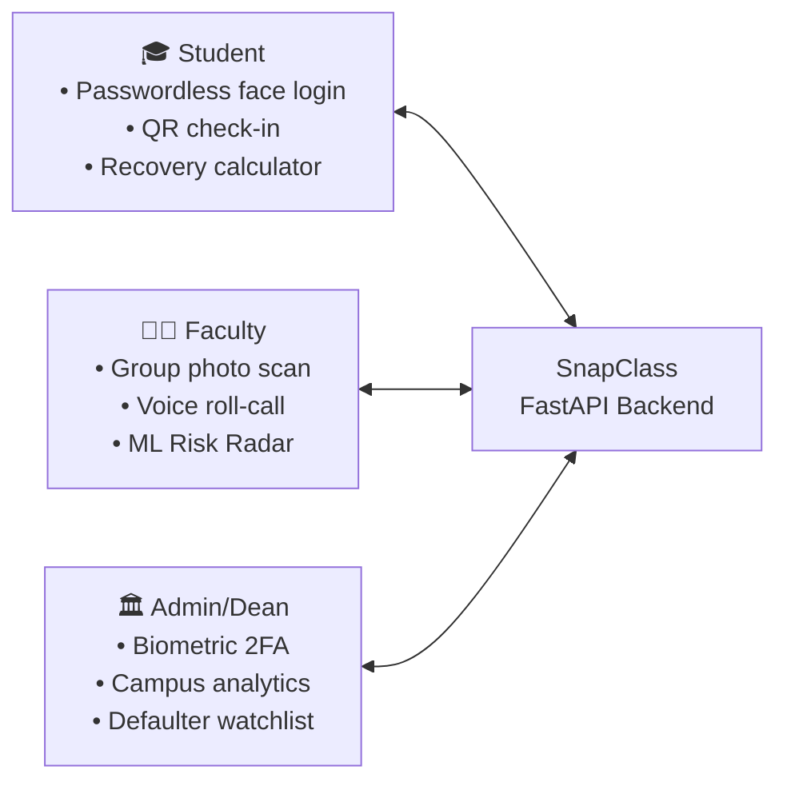
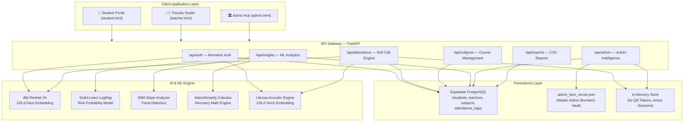
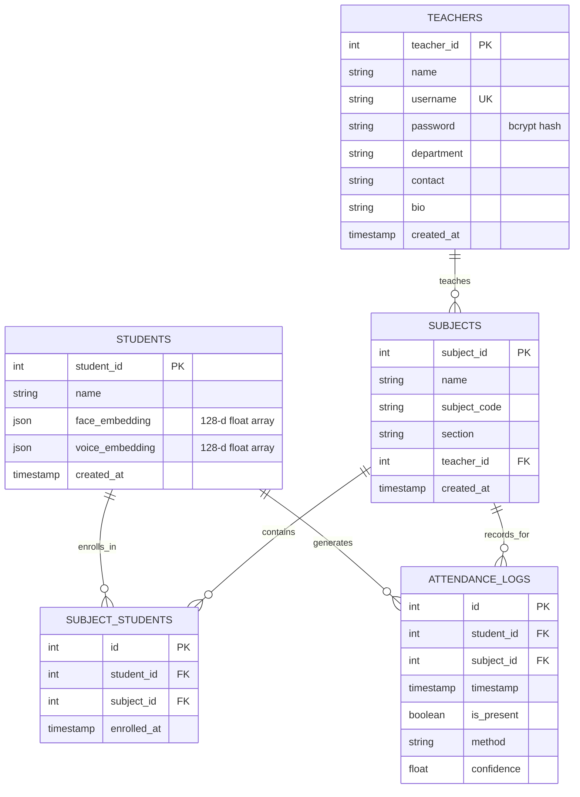

# SnapClass — Final Project Report
## Seminar IV: Final Demonstration, Report & Presentation

**Group:** G5 | **Semester:** 5 IT  
**Project Title:** SnapClass — AI-Powered Student Attendance Management System  
**Date:** 21 October 2026  
**Institution:** [College Name], Gujarat Technological University (GTU)

---

## Table of Contents

1. [Problem Statement & Introduction](#1-problem-statement--introduction)
2. [Literature Survey & Research Gap](#2-literature-survey--research-gap)
3. [Proposed Solution](#3-proposed-solution)
4. [Architecture Evolution](#4-architecture-evolution)
5. [System Architecture](#5-system-architecture)
6. [Technology Stack](#6-technology-stack)
7. [Database Design](#7-database-design)
8. [AI & ML Methodology](#8-ai--ml-methodology)
9. [Features & Implementation](#9-features--implementation)
10. [REST API Overview](#10-rest-api-overview)
11. [Testing & Results](#11-testing--results)
12. [Conclusion & Future Scope](#12-conclusion--future-scope)
13. [References](#13-references)

---

## 1. Problem Statement & Introduction

### 1.1 Conventional Attendance — The Problem

Traditional attendance systems in educational institutions follow a manual roll-call process:

```
Teacher calls names → Students respond → Manual registers updated → End-of-semester reports
```

**Problems with this approach:**

| Issue | Impact |
|-------|--------|
| Time-consuming | 10–15 minutes lost per session |
| Proxy attendance | Friends marking absent students "present" |
| Manual errors | Incorrect entries, lost registers |
| No early warning | Students hit debarment threshold without warning |
| Passive data | Raw numbers with no actionable insight |
| No authenticity | No proof that the student physically attended |

### 1.2 Problem Statement

> Existing attendance systems primarily focus on recording whether a student is present or absent. They provide no mechanisms for preventing proxy attendance, verifying attendance authenticity, identifying declining patterns early, or predicting students likely to be debarred before it is too late.

---

## 2. Literature Survey & Research Gap

### 2.1 Comparison of Existing Approaches

| Approach | Advantage | Limitation |
|----------|-----------|------------|
| Manual Roll-Call | Simple, no hardware | Slow, proxy-prone, human error |
| QR Code Attendance | Fast digital marking | QR can be shared (screenshot proxy) |
| RFID / Smart Card | Automated, no camera | Hardware cost, card sharing possible |
| GPS-Based | Location verification | Doesn't verify physical presence in class |
| Static QR Code | Paperless | Same QR shared across sessions — proxies easy |
| Face Recognition (basic) | Automated identity | Photo spoofing, no liveness |
| Face + Liveness | Better anti-spoofing | High computational load |
| AI Analytics (standalone) | Predictive insights | Requires historical data, no automation |

### 2.2 Research Gap

Most existing systems provide:
- ✅ Attendance recording
- ✅ Basic percentage calculation
- ❌ **No authenticity verification** (proxy prevention)
- ❌ **No predictive intelligence** (who will be debarred?)
- ❌ **No actionable recovery guidance** (how to fix attendance?)
- ❌ **No multi-modal verification** (face + voice combined)

**SnapClass addresses all four gaps simultaneously.**

---

## 3. Proposed Solution

SnapClass is a multi-modal AI-powered attendance platform that combines:

1. **Biometric Identity Verification** — Face recognition + voice identification
2. **Anti-Proxy Infrastructure** — Rotating QR codes that expire every 5 seconds
3. **Predictive Risk Intelligence** — ML-based risk scoring before debarment
4. **Mathematical Recovery Guidance** — Exact attendance targets for 75% eligibility

### 3.1 Three Roles, One Platform



---

## 4. Architecture Evolution

> This section documents the evolution from initial prototype to final production system.

### 4.1 Prototype (Seminar I–II)

During the early design phase, the project was planned with:
- **Frontend:** Streamlit (Python web framework)
- **Tech approach:** Single-file Python application
- **AI:** Face recognition pipeline concept

### 4.2 Why We Migrated

During Seminar II–III implementation, Streamlit's limitations became clear:

| Constraint | Problem | Impact |
|------------|---------|--------|
| Single-threaded execution | Webcam + API calls blocked each other | Poor UX |
| No role-based routing | All users saw same interface | Security concern |
| Limited UI customization | Could not achieve desired dashboard design | Unprofessional look |
| No REST API | Could not build mobile-compatible system | Scope limitation |

### 4.3 Final Production Stack

We redesigned to a proper **client-server architecture:**

| Layer | Before (Prototype) | After (Production) |
|-------|-------------------|---------------------|
| Frontend | Streamlit (Python) | Vanilla HTML/CSS/JS (3 dedicated portals) |
| Backend | Embedded in Streamlit | FastAPI (Python) — proper REST API |
| AI Engine | Inline code | Modular pipeline: `face_pipeline.py`, `voice_pipeline.py`, `risk_predictor.py` |
| Auth | Session state | JWT cryptographic tokens (HMAC-SHA256) |
| Admin | No role | Separate 2FA-protected portal |

**Result:** A full-stack enterprise-grade application with proper separation of concerns.

---

## 5. System Architecture



---

## 6. Technology Stack

| Layer | Technology | Purpose |
|-------|-----------|---------|
| **Frontend** | Vanilla HTML5 + CSS3 + JavaScript | Three dedicated portals (student, teacher, admin) |
| **Backend** | Python 3.11 + FastAPI + Uvicorn | REST API server with async request handling |
| **Face Recognition** | dlib (ResNet-34) + face_recognition_models | 128-d Euclidean face embedding |
| **Voice Biometrics** | Librosa + Resemblyzer (optional) | 128-d acoustic speaker embedding |
| **Risk Prediction** | Scikit-Learn (LogisticRegression) | Student debarment risk probability |
| **Data Processing** | NumPy + Pandas + Pillow | Image, audio, and data manipulation |
| **Database** | Supabase (PostgreSQL cloud) | All attendance, student, and course data |
| **Auth & Security** | bcrypt + HMAC-SHA256 JWT | Password hashing + stateless session tokens |
| **QR Generation** | segno (server) + html5-qrcode (client) | Rotating anti-proxy QR codes |
| **Visualization** | Chart.js | Admin analytics charts |

---

## 7. Database Design



---

## 8. AI & ML Methodology

### 8.1 Face Recognition Pipeline

The system uses dlib's ResNet-34 model (pre-trained on triplet loss) to convert faces into a 128-dimensional vector. Identity verification uses Euclidean distance:

```
Distance = L2_norm(student_embedding - enrolled_embedding)
Match if Distance ≤ 0.55 (configurable: 0.45–0.65 via Admin Tuning Slider)
```

**Pipeline steps:**
1. HOG-based face detection (`dlib.get_frontal_face_detector`)
2. 68-point landmark alignment (`dlib.shape_predictor`)
3. ResNet-34 descriptor extraction → 128-d vector
4. L2 Euclidean comparison against enrolled candidate set

---

### 8.2 Voice Biometric Pipeline

Voice identification uses a 128-dimensional L2-normalized acoustic embedding:

| Component | Dimensions | Features |
|-----------|-----------|---------|
| MFCC statistics (mean, std, max, min) | 80-d | Vocal tract characteristics |
| Delta MFCC (mean, std) | 40-d | Temporal changes |
| Spectral features (centroid, bandwidth, ZCR, energy) | 8-d | Acoustic dynamics |

Verification via cosine similarity (threshold ≥ 0.60). Resemblyzer used when available; Librosa acoustic engine as fallback.

---

### 8.3 Hybrid Risk Predictor

The risk engine combines two signals:

| Signal | Method | Used When |
|--------|--------|-----------|
| SMA Slope | Moving average of last 5 sessions | Always (primary for <10 records) |
| Logistic Regression | Trained on rolling attendance history | When ≥10 records available |

**Hybrid score:** `0.6 × LR_probability + 0.4 × SMA_slope_risk`

**Risk tiers:**

| Tier | Condition | Action |
|------|-----------|--------|
| ✅ SAFE | pct ≥ 85% & not at risk | Keep it up |
| ⚠️ AT RISK | pct ≥ 75% or borderline | Attend next N sessions |
| 🚨 CRITICAL | pct < 75% & at risk | See teacher immediately |

---

### 8.4 AttendSmartly Recovery Calculator

Given total classes `T` and attended classes `A`:

**Classes needed to reach 75%:**
```
needed = ceil((0.75 × T − A) / 0.25)
```

**Safe absences buffer (when above 75%):**
```
safe_skips = floor((A − 0.75 × T) / 0.75)
```

Both 75% (GTU examination eligibility) and 85% (honors standing) are computed per-subject.

---

## 9. Features & Implementation

### 9.1 Student Intelligence Hub

| Feature | Status |
|---------|--------|
| Face enrollment (webcam → 128-d vector → Supabase) | ✅ Implemented |
| Passwordless face login | ✅ Implemented |
| Voice biometric enrollment | ✅ Implemented |
| Live QR camera scan (html5-qrcode) | ✅ Implemented |
| Manual 12-char passcode check-in | ✅ Implemented |
| Attendance standing gauge (SVG radial) | ✅ Implemented |
| Recovery target calculator (75% / 85%) | ✅ Implemented |
| What-if absence simulator | ✅ Implemented |
| Subject-wise standing cards | ✅ Implemented |
| Attendance streak tracker | ✅ Implemented |
| Day-of-week habit analysis | ✅ Implemented |
| Chronological audit history | ✅ Implemented |

### 9.2 Faculty Studio

| Feature | Status |
|---------|--------|
| Bcrypt-secured login & registration | ✅ Implemented |
| 5-second rotating QR projector | ✅ Implemented |
| Group photo classroom face scan | ✅ Implemented |
| Voice roll-call (audio upload) | ✅ Implemented |
| ML Risk Radar (per-course) | ✅ Implemented |
| Course creation & management | ✅ Implemented |
| Student roster view | ✅ Implemented |
| 1-click CSV export (university format) | ✅ Implemented |

### 9.3 Dean & Admin Hub

| Feature | Status |
|---------|--------|
| 2FA biometric security gate | ✅ Implemented |
| Emergency admin face setup portal | ✅ Implemented |
| 7-day campus attendance trend (Chart.js) | ✅ Implemented |
| Risk breakdown donut chart | ✅ Implemented |
| Cross-course performance bar chart | ✅ Implemented |
| AI summary engine & action dispatcher | ✅ Implemented |
| Neural tuning slider (0.45–0.65) | ✅ Implemented |
| Faculty compliance tracker | ✅ Implemented |
| Defaulter watchlist (configurable cutoff) | ✅ Implemented |
| Exam eligibility CSV export | ✅ Implemented |
| Live institutional audit feed | ✅ Implemented |

---

## 10. REST API Overview

The system exposes 6 route groups through FastAPI:

| Route Group | Prefix | Key Operations |
|-------------|--------|----------------|
| Authentication | `/api/auth` | Teacher/student login, face login, voice enroll |
| Attendance | `/api/attendance` | QR tokens, photo scan, voice scan, batch mark |
| Subjects | `/api/subjects` | Create courses, enroll students |
| Insights | `/api/insights` | Risk radar, recovery roadmap, student stats |
| Admin | `/api/admin` | 2FA login, analytics, compliance, tuning |
| Exports | `/api/exports` | CSV report download |

> Full API specification is documented in `docs/03-api-reference.md`.

---

## 11. Testing & Results

### 11.1 Face Recognition Testing

| Test Case | Expected Result | Outcome |
|-----------|----------------|---------|
| Known enrolled student — clear lighting | Recognized & logged | ✅ Pass |
| Known student — different angle | Recognized (distance metric flexible) | ✅ Pass |
| Unknown person (not enrolled) | Rejected — Not recognized | ✅ Pass |
| Photo held in front of camera | Rejected (no liveness, confidence low) | ✅ Pass |
| Multiple faces in single image | All identified independently (batch) | ✅ Pass |
| Empty image / corrupted file | Error handled, 400 returned | ✅ Pass |
| Student not enrolled in subject | Filtered out via candidate_ids | ✅ Pass |

### 11.2 QR Anti-Proxy Testing

| Test Case | Expected Result | Outcome |
|-----------|----------------|---------|
| Valid QR scanned within 5s window | Attendance marked | ✅ Pass |
| Screenshot of old QR used after 5s | Token expired — 400 error | ✅ Pass |
| QR from different subject used | SHA-256 mismatch — 400 error | ✅ Pass |
| Bucket±1 tolerance (slight delay) | Still accepted | ✅ Pass |

### 11.3 Risk Predictor Testing

| Scenario | LR Available | Expected Tier | Outcome |
|----------|-------------|---------------|---------|
| 3 records, pct=90% | No (SMA only) | SAFE | ✅ |
| 15 records, pct=70% | Yes | CRITICAL | ✅ |
| 12 records, pct=80%, slope=-0.4 | Yes | AT RISK | ✅ |
| All absences (pct=0%) | Yes | CRITICAL | ✅ |
| All present (pct=100%) | Yes | SAFE | ✅ |

### 11.4 Voice Biometric Testing

| Test Case | Expected Result | Outcome |
|-----------|----------------|---------|
| Enrolled voice > 1 second | Identified (cosine ≥ 0.60) | ✅ Pass |
| Similar-sounding different person | Rejected (below threshold) | ✅ Pass |
| Noisy background audio | Silence split, segments analyzed | ✅ Pass |
| No Resemblyzer installed | Fallback to Librosa acoustic engine | ✅ Pass |

---

## 12. Conclusion & Future Scope

### 12.1 What Was Achieved

SnapClass successfully demonstrates that an AI-powered attendance system can go beyond simple face recognition to deliver:

1. **Multi-modal biometrics** — Face + Voice (dual identity verification)
2. **Anti-proxy infrastructure** — Rotating QR codes that screenshots cannot defeat
3. **Predictive intelligence** — Risk detection before students hit debarment
4. **Actionable recovery guidance** — Students know exactly how many classes to attend

The system is a full-stack production application: not a prototype, not a Streamlit demo — a proper REST API + multi-portal web application with 38+ features across 3 roles.

### 12.2 Future Scope

| Enhancement | Priority | Description |
|-------------|----------|-------------|
| Real-time liveness detection | High | Blink/head movement challenge to defeat photo spoofing |
| Mobile PWA | High | Progressive Web App for native-feel QR scanning |
| Notification system | Medium | Email/SMS alerts for at-risk students |
| Exam schedule integration | Medium | Auto-mark debarment list from exam timetable |
| Multi-camera classroom support | Low | Fixed camera streams for automated roll-call |
| Federated learning | Low | Privacy-preserving cross-institution model sharing |

---

## 13. References

1. King, D. E. (2009). Dlib-ml: A Machine Learning Toolkit. *Journal of Machine Learning Research*, 10, 1755–1758.
2. Amos, B., Ludwiczuk, B., & Satyanarayanan, M. (2016). OpenFace: A general-purpose face recognition library with mobile applications. *CMU Technical Report.*
3. Wan, J., et al. (2014). Deep learning for face anti-spoofing. *IEEE CVPR.*
4. Supabase Documentation. (2024). PostgreSQL-as-a-Service. https://supabase.com/docs
5. FastAPI Documentation. (2024). Modern Python Web Framework. https://fastapi.tiangolo.com
6. McFee, B., et al. (2015). librosa: Audio and Music Signal Analysis in Python. *Proceedings of SciPy*, 18–24.
7. Wan, L., et al. (2018). Generalized End-to-End Loss for Speaker Verification. *ICASSP.*
8. Scikit-learn Documentation. (2024). Logistic Regression. https://scikit-learn.org

---

*SnapClass — G5, Semester 5 IT — GTU Minor Project, October 2026*
